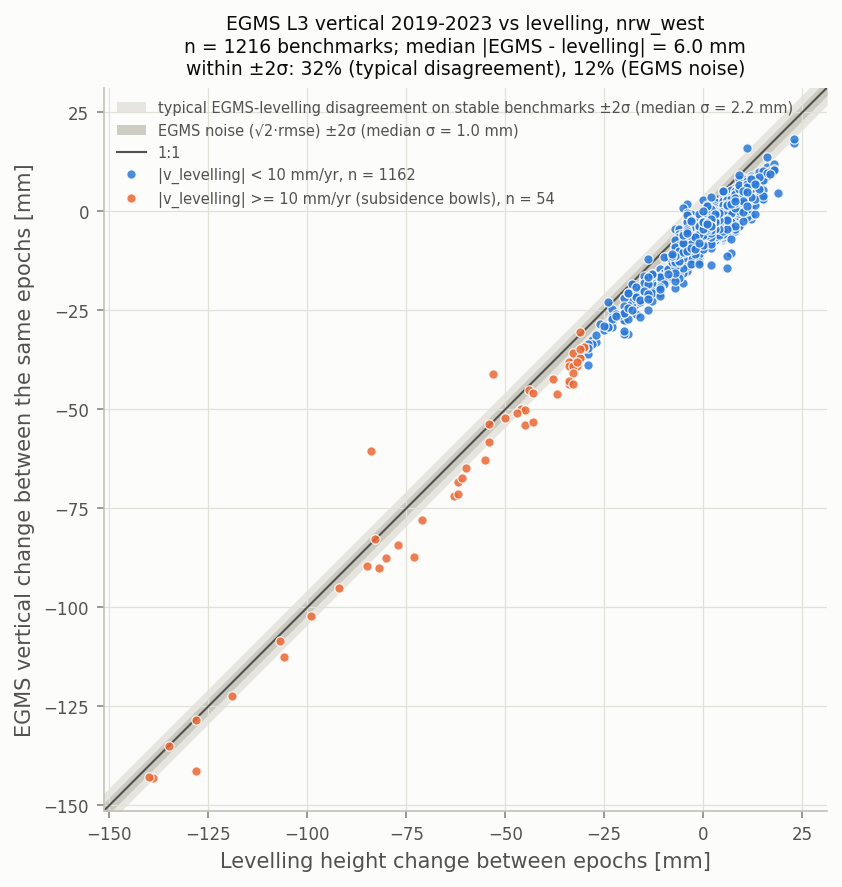
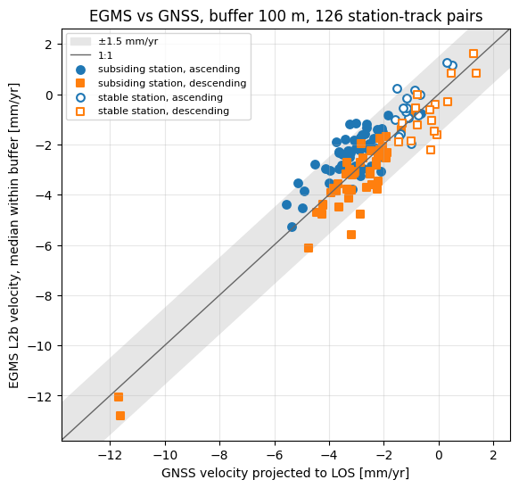

# EGMS Check: does satellite InSAR agree with ground measurements?

[](https://github.com/geoworldlook/egms-check/actions/workflows/selftest.yml)
[](https://colab.research.google.com/github/geoworldlook/egms-check/blob/main/notebooks/EGMS_Check.ipynb)


EGMS Check tests the [European Ground Motion Service](https://egms.land.copernicus.eu/) (EGMS, Copernicus) against
two independent kinds of ground measurement: permanent GNSS stations and state precise levelling. EGMS shows how the
ground moves all over Europe, measured by the Sentinel-1 radar satellites (InSAR, radar interferometry). The question
is practical: can EGMS be trusted to monitor slow subsidence (the ground going down), and where does it stop working?
The project uses only open data.

**Checked against the ground:** on 1,216 levelling benchmarks in North Rhine-Westphalia (Germany), EGMS shows the same
height change as levelling: slope 0.96, up to −140 mm in 3 years, and the same direction of motion at all 54 benchmarks
in subsidence bowls. A constant offset of about −2 mm/yr remains, so 3 of the 4 rules fixed before computing are not
met — and we report that. In Groningen (the Netherlands), GNSS confirms the EGMS subsidence rate within 1.5 mm/yr for
91% of station × track pairs (EGMS release 2019–2023) and 99% (release 2020–2024).

## Product card

| | |
|---|---|
| **Problem** | EGMS is free and covers all of Europe, but a user cannot see how far its numbers can be trusted in one area. Official validation reports give results for Europe as a whole, not for a given place. |
| **User** | People who want to use EGMS to watch slow ground motion (gas and mining areas, groundwater): for example infrastructure managers, surveyors and geological services. |
| **Solution** | A pipeline that downloads EGMS for an area, finds independent ground measurements (GNSS stations, levelling benchmarks) and compares them with the method of the official EGMS validation. The verdict follows rules written down before computing (pre-registration). One command on a normal computer; Colab as backup. |
| **Evidence** | Groningen (gas field): EGMS and GNSS agree within 1.5 mm/yr for 91% of pairs (2019–2023, n = 95) and 99% (2020–2024, n = 93); slope 0.96. North Rhine-Westphalia (lignite mining): 1,216 benchmarks, slope 0.96, same direction of motion in 100% of subsidence-bowl benchmarks; constant offset −1.97 mm/yr, so the pre-registered main variant fails 3 of 4 rules. Failed rules are reported as failed (see below). |
| **Status** | Stage A (EGMS against GNSS and levelling) runs end to end on real data. Stage B (own Sentinel-1 processing, to go beyond the yearly EGMS release) is built and tested only on synthetic data. Self-assessed technology readiness: TRL 4 (validated on real data in two regions; not yet tested with users). |
| **Limits** | Two regions, flat terrain, slow motion (up to −140 mm in 3 years). EGMS is updated once a year: it is an archive, not an early warning. EGMS is calibrated with a GNSS model, so the GNSS check is not fully independent; the levelling check is. No statement about fast or sudden motion, landslides or single buildings. |
| **Next** | Same rules on the next EGMS release; stage B on real data (Groningen, 2024–2026); test the cause of the −2 mm/yr offset with a protocol written before computing. |



*EGMS L3 vertical (release 2019–2023) against state levelling, 05.2019 → 05.2022. Orange: benchmarks in subsidence
bowls (|v| ≥ 10 mm/yr). Grey bands: EGMS uncertainty (informative, no threshold).*

## Results

All rules (thresholds) were written in the code **before** any comparison was computed, and they were not changed
after the results. Full table (in Polish): [`docs/evidence/karta_wynikow.md`](docs/evidence/karta_wynikow.md);
machine-readable: [`docs/showcase/egmscheck_results.json`](docs/showcase/egmscheck_results.json).

### Experiment 1: EGMS L2b vs GNSS, Groningen gas field

35 GNSS stations chosen by a fixed rule, without manual picking: 27 subsiding stations and 8 stable control stations.
24 subsiding stations have EGMS points within 100 m. dv = GNSS velocity − EGMS velocity, both in the satellite's line
of sight (LOS).

| Rule | Release 2019–2023 (main test) | Release 2020–2024 (repeat) | Threshold |
|---|---|---|---|
| K1 rate agreement: pairs with \|dv\| ≤ 1.5 mm/yr | 91% (n = 95) — met | 99% (n = 93) — met | ≥ 80% |
| K2 time-series agreement: median std of the difference | 4.7 mm — met, at the limit | 4.7 mm — met | ≤ 5 mm |
| K3 stable stations | max \|v_EGMS\| 2.22 mm/yr (n = 31) — **not met** | max \|dv\| 1.62 mm/yr (n = 32) — **not met** | ≤ 1.5 mm/yr |
| Slope EGMS vs GNSS (informative) | 0.96 | 0.94 | ≈ 1 |

**Verdict: PARTIAL** for both releases. EGMS reproduces the subsidence *rate* within about 1.5 mm/yr. Its seasonal
signal is muted: the L2b calibration to a GNSS velocity model damps the annual cycle, as the literature also says.
K3 fails because the "stable" stations also move a little in the satellite's direction in GNSS. For the repeat, K3
compares EGMS with GNSS (max |dv|); this definition was chosen after experiment 1 but before computing the repeat.
EGMS L3 vertical vs GNSS up: 96% of pairs within 1.5 mm/yr (n = 24), slope 0.96.



### Experiment 2: EGMS L3 Ortho (vertical) vs state levelling, western North Rhine-Westphalia

Of 1,491 benchmarks with two levelling epochs in the EGMS window (mostly 05.2019 → 05.2022), 1,216 have an EGMS L3
cell. There was no selection based on EGMS values.

| Rule | Main variant (absolute) | Relative to stable benchmarks (computed after) | Threshold |
|---|---|---|---|
| N1 median \|Δh_EGMS − Δh_levelling\| | 6.0 mm — **not met** | 3.4 mm — met | ≤ 5 mm |
| N2 same sign (\|Δh\| ≥ 6 mm) | 77% — **not met** | 94% — met | ≥ 90% |
| N3 stable benchmarks: median \|Δh_EGMS\| | 3.7 mm — met | — | ≤ 5 mm |
| N4 velocity bias | −1.97 mm/yr — **not met** | −1.00 mm/yr — met | \|bias\| ≤ 1.5 mm/yr |

- Slope 0.96 ± 0.01 over the range −140 to +25 mm.
- In subsidence bowls (54 benchmarks with |v| ≥ 10 mm/yr): **100% same sign**, slope 0.98.

**Verdict:** EGMS shows *where* and *how much* the ground moves. A constant offset of about −2 mm/yr separates it from
the levelling datum. The main variant was fixed in advance, so its formal verdict stays a fail; the relative variant
is reported next to it, not instead of it.

### Negative and inconclusive results

- **K3 failed in both Groningen tests** (above). The verdict stays PARTIAL.
- **3 of 4 levelling rules failed** in the main variant (above). The cause of the offset (different reference
  frames) is a hypothesis, not tested yet.
- **GNSS in western North Rhine-Westphalia: inconclusive.** No GNSS station there is subsiding and meets the quality
  rule, so K1 cannot be computed.
- **EGMS uncertainty is too optimistic.** Only 12% of benchmarks fall inside ±2σ of the EGMS `rmse` noise band
  (37% after removing the offset).
- **Time to detect motion (descriptive):** a 2σ trend test flags subsiding stations after a median of 9 months in EGMS
  (12 months after Sentinel-1B ended in December 2021) and 18 months in GNSS, but it also flags most stable stations.
  So this measure does not separate moving from stable ground yet and is not used for conclusions.

Short summaries in English, with figures: [Groningen (GNSS)](notebooks/Showcase_1_GNSS_Groningen.ipynb) ·
[North Rhine-Westphalia (levelling)](notebooks/Showcase_2_Levelling_NRW.ipynb). Detailed write-ups (in Polish):
[E1 Groningen](docs/evidence/F9_E1_interpretacja_wynikow.md) · [E2 levelling](docs/evidence/F10_NRW_niwelacja_EGMS.md).

## Method

1. **EGMS points near the ground station:** all points within 100 m, median per acquisition date (method of the
   official EGMS validation, Koudogbo et al. 2025). For levelling: the EGMS L3 cell (100 m) that contains the benchmark.
2. **Projection:** GNSS motion in east, north and up is projected onto the satellite line of sight with the LOS unit
   vector taken from EGMS.
3. **Common dates and reference:** GNSS median within ±6 days of each pass; both series start from zero on the same date.
4. **Same model for both series:** trend plus an annual sinusoid fitted over the same window; then velocity
   differences, series residuals and correlation. Levelling: EGMS read at the two levelling dates (linear
   interpolation, no extrapolation).
5. **Blocking checks before any comparison:** LOS vector norm, incidence angle, orbit-geometry sign, duplicates from
   burst overlaps (206 points removed in Groningen). A failed check stops the run.

Limitation: EGMS L2b and L3 are calibrated with a GNSS velocity model (including stations of the network used here),
so the absolute velocity agreement with GNSS is not fully independent. Levelling is.

## Code

```text
egmscheck/                   package: python -m egmscheck run | publish | selftest | settings (docs/ARCHITEKTURA.md)
├── __main__.py              commands (same parser as step_09_local.py)
└── publish.py               a fixed set of results -> docs/showcase/ + egmscheck_results.json
step_00_reference_check.py   consistency checks of tables transcribed from publications
step_01_ingest.py            EGMS API (search, download, SHA-256 manifest), NGL GNSS series
step_02_checks_extract.py    EGMS convention checks, burst-overlap duplicates, extracts around stations
step_03_compare_gnss.py      LOS projection, common window, velocities, rules K1–K4, figures
step_04_egms_aoi.py          EGMS L2b/L3 search and download plan for an area, L3 reader
step_05_colab_run.py         configuration (CHECK_CONFIG), run_task, registry, tasks
step_06_ground.py            GNSS in an area, NRW levelling, rules N1–N4, relative variant
step_07_monitoring.py        common series format, sampling, time to detection, figures
step_08_hyp3_mintpy.py       stage B: own Sentinel-1 processing (ASF HyP3 + MintPy)
step_09_local.py             local runs: settings, task plan, lock, log
build_colab_*.py             notebook generators (notebooks are never edited by hand)
notebooks/                   EGMS_Check (experiment 1), EGMS_Monitoring (Colab), two English showcase notebooks
tests/                       offline harnesses (local run; Colab notebooks on Linux)
docs/                        status, architecture, evidence and plans (in Polish); showcase/ = published results
```

The `step_0N` modules stay in the main folder because the Colab notebooks import them; the package calls them.

## How to run

**On your own computer (Windows, macOS, Linux):** create the conda environment from `environment.yml`, point
`local_settings.json` at the data folder (code and data stay in separate folders), then:

```bash
python -m egmscheck run --dry-run    # list of tasks, no computing
python -m egmscheck run              # stage A for all regions; large EGMS downloads need a size confirmation
python -m egmscheck publish          # copy the results to docs/showcase/, commit and push (--no-git: copy only)
```

Guide (in Polish): [`docs/URUCHOMIENIE_LOKALNE.md`](docs/URUCHOMIENIE_LOKALNE.md). EGMS is updated once a year, so
there is no weekly job: run it when a new release comes out. A CLMS service key is needed to download EGMS; without
it, the run reads the existing extracts.

**In Colab (backup):** open `notebooks/EGMS_Monitoring.ipynb` and choose *Run all*. Reading results only:
`notebooks/EGMS_Check.ipynb` is stored executed, so its tables and figures can be read on GitHub.

**Offline, without network or keys:**

```bash
pip install -e ".[stage-b]" ruff
python -m egmscheck selftest         # offline tests of all modules (the same runs in CI)
python -m egmscheck test             # full offline test: fake servers, synthetic data with a known answer
ruff check .
```

## Data and attribution

- **EGMS:** generated using European Union's Copernicus Land Monitoring Service information (European Ground
  Motion Service; the results here are modified: extracts, comparisons, figures). Products and DOIs (EEA catalogue):
  Calibrated 2019–2023, https://doi.org/10.2909/8889e0a7-a6df-47a8-b4e7-a9cb32cbbf6b; Ortho – Vertical Component
  2019–2023, https://doi.org/10.2909/9abe5dd1-3639-4aeb-a8de-ec2eb2f7fc93; release 2020–2024 within the series
  Calibrated 2016–present, https://doi.org/10.2909/4137af9a-e3b6-405b-b714-e0cb5e9ca7d5, and Ortho – Vertical
  Component 2016–present, https://doi.org/10.2909/4778163b-23bb-4403-af70-7accbc56e7d3. Downloaded through the EGMS
  API, https://egms.land.copernicus.eu (2026-10-10 … 10-13).
- **GNSS:** Nevada Geodetic Laboratory (NGL), daily series in IGS20 with the Eurasian plate removed; velocities MIDAS.
  Blewitt, G., Hammond, W. C., Kreemer, C. (2018), *Eos* 99, https://doi.org/10.1029/2018EO104623; Blewitt et al.
  (2016), *J. Geophys. Res. Solid Earth* 121, 2054–2068.
- **Levelling:** Geobasis NRW, Höhenfestpunkte (DHHN2016), Datenlizenz Deutschland – Zero – Version 2.0. The format
  description is linked, not copied: [`docs/evidence/zrodla/README.md`](docs/evidence/zrodla/README.md).
- **Reference values from publications:** Koudogbo et al. 2025 (EGMS validation report); Fabris & Nazari 2026
  (*Front. Earth Sci.* 14:1781404); Even et al. 2024.

## How it is built

I build this project with help from Claude, an AI assistant made by Anthropic. Claude helps with code, analysis runs
and documentation. I set the goals and the methods, review the results and make the decisions. Every result is
checked against ground measurements, as described above.

## License

Code: [MIT](LICENSE). Data remain under their providers' licences (above). Documentation in [`docs/`](docs/) is in
Polish; the first Polish project description is in [`docs/archive/`](docs/archive/). Changes:
[`CHANGELOG.md`](CHANGELOG.md).
