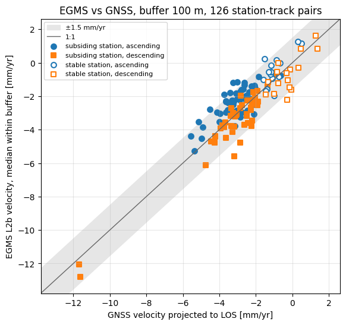

# EGMS Check: does satellite InSAR agree with ground measurements?

[](https://colab.research.google.com/github/geoworldlook/egms-check/blob/main/notebooks/EGMS_Check.ipynb)


This project validates the [European Ground Motion Service](https://egms.land.copernicus.eu/) (EGMS, Copernicus,
Sentinel-1 InSAR) against two fully independent kinds of ground truth: permanent GNSS stations and national
precise levelling. The question is practical: can EGMS be trusted to monitor slow subsidence, and where does it stop working?

**Skills shown:** InSAR / SAR · ground-motion validation · GNSS time series · geodetic reference frames ·
pre-registered acceptance criteria · Python data pipelines.



## Results

Acceptance criteria and reference choices were written down **before** any comparison was computed,
and they were not changed after seeing the results.

### Experiment 1: EGMS L2b vs GNSS, Groningen gas field (release 2019–2023)

35 GNSS stations chosen by a fixed rule, without manual picking: 27 subsiding stations and 8 stable control stations.
24 subsiding stations have EGMS points within 100 m.

| Criterion | Result | Threshold | Met |
|---|---|---|---|
| K1 velocity agreement | 91% of station × track pairs with \|Δv\| ≤ 1.5 mm/yr (n = 95) | ≥ 80% | yes |
| K2 time-series agreement | median std of the difference 4.7 mm | ≤ 5 mm | yes, at the limit |
| K3 stable stations | max \|v_EGMS\| = 2.22 mm/yr (n = 31) | ≤ 1.5 mm/yr | no |
| Slope EGMS vs GNSS | 0.96 (intercept +0.05 mm/yr) | ≈ 1 | informative |

**Verdict: PARTIAL.** EGMS reproduces the subsidence *rate* within about 1.5 mm/yr. Its seasonal signal is muted:
the L2b calibration to a GNSS velocity model damps the annual cycle, which is consistent with the literature.

### Experiment 2: EGMS L3 Ortho (vertical) vs state levelling, western North Rhine-Westphalia

Of 1,491 benchmarks with two levelling epochs (05.2019 → 05.2022), 1,216 have an EGMS L3 cell.
There was no selection based on EGMS values.

| | Absolute (main variant) | Relative to stable benchmarks |
|---|---|---|
| N1 median \|Δh_EGMS − Δh_levelling\| | 6.0 mm (fails ≤ 5 mm) | 3.4 mm (passes) |
| N2 sign agreement (\|Δh\| ≥ 6 mm) | 77% (fails ≥ 90%) | 94% (passes) |
| N3 stable benchmarks | 3.7 mm (passes ≤ 5 mm) | — |
| N4 velocity bias | −1.97 mm/yr (fails \|bias\| ≤ 1.5) | −1.00 mm/yr (passes) |

- Slope 0.96 ± 0.01 over the range −140 to +25 mm.
- In subsidence bowls (54 benchmarks with \|v\| ≥ 10 mm/yr): **100% sign agreement**, slope 0.98.

**Verdict:** EGMS shows *where* and *how much* the ground moves. A constant offset of about −2 mm/yr separates it from
the levelling datum. Because the main variant was fixed in advance, its formal verdict stays a fail.

Short summaries in English, with figures: [Groningen (GNSS)](notebooks/Showcase_1_GNSS_Groningen.ipynb) ·
[North Rhine-Westphalia (levelling)](notebooks/Showcase_2_Levelling_NRW.ipynb).

Detailed write-ups (in Polish): [E1 Groningen](docs/evidence/F9_E1_interpretacja_wynikow.md) ·
[E2 NRW levelling](docs/evidence/F10_NRW_niwelacja_EGMS.md).

## Method

1. **EGMS points near the ground station:** all points within 100 m, taking the median per acquisition date
   (official EGMS validation method, Koudogbo et al. 2025).
2. **Projection:** GNSS displacement in east, north and up is projected onto the satellite line of sight (LOS)
   with the LOS unit vector taken from EGMS.
3. **Common dates and reference:** GNSS median within ±6 days of each pass; both series zeroed on the same date.
4. **Same model for both series:** trend plus an annual sinusoid fitted over the same window; then velocity
   differences, series residuals and correlation.
5. **Blocking checks before comparison:**
   - LOS vector norm and incidence-angle consistency;
   - orbit-geometry sign;
   - removal of duplicates from burst overlaps (206 points).

Limitation: EGMS L2b is calibrated with GNSS (including the NGL stations used here), so the absolute velocity
agreement in E1 is not fully independent. Levelling in E2 is.

## Repository structure

```text
├── step_00_reference_check.py   # consistency checks of tables transcribed from publications
├── step_01_ingest.py            # EGMS API (search, download, SHA-256 manifest), NGL GNSS series
├── step_02_checks_extract.py    # EGMS convention checks, burst-overlap duplicates, extracts around stations
├── step_03_compare_gnss.py      # E1: LOS projection, common window, velocities, verdict, figures
├── step_04_egms_aoi.py          # EGMS L2b/L3 search and download plan for an area
├── step_05_colab_run.py         # notebook control, Drive registry, tasks
├── step_06_ground.py            # ground data: GNSS in an area, NRW levelling, relative-to-stable variant
├── step_07_monitoring.py        # common series format, sampling, maps and uncertainty bands
├── step_08_hyp3_mintpy.py       # stage B: own Sentinel-1 processing (ASF HyP3 + MintPy)
├── build_colab_*.py             # notebook generators (notebooks are never edited by hand)
├── notebooks/                   # two English showcase notebooks, EGMS_Monitoring, EGMS_Check (E1)
├── tests/                       # offline harnesses with fake Colab, GDAL and MintPy modules
├── data/04_Reference/           # numbers transcribed from publications for cross-checks
└── docs/                        # plans, evidence F1–F10, architecture (in Polish)
```

## How to run

- **Reading results:** `notebooks/EGMS_Check.ipynb` is stored executed, so its tables and figures can be read on GitHub without running anything.
- **Rerunning:** open the notebook in Colab (badge above) and choose *Run all*. It needs Google Drive and a CLMS
  service key, and the EGMS download (about 4.4 GB for Groningen) runs only after its size is approved in section 5.
  Raw data and extracts stay on Drive, not in the repository.

```bash
python step_00_reference_check.py   # offline check of the reference tables
```

**Dependencies:** `numpy pandas scipy geopandas pyproj shapely matplotlib requests pyjwt`.

## Data and attribution

- EGMS: Copernicus Land Monitoring Service, European Ground Motion Service.
- GNSS: Nevada Geodetic Laboratory (Blewitt et al. 2018), IGS20, Eurasian plate removed.
- Levelling: Geobasis NRW, Höhenfestpunkte (DHHN2016).
- Reference values:
  - Koudogbo et al. 2025;
  - Fabris & Nazari 2026 (Front. Earth Sci. 14:1781404);
  - Even et al. 2024.

## License

Code: [MIT](LICENSE). Data remain under their providers' licences.

---

A Polish version of the project description is in [`docs/README_pl.md`](docs/README_pl.md).
