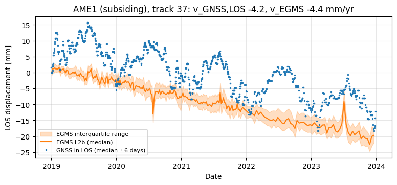
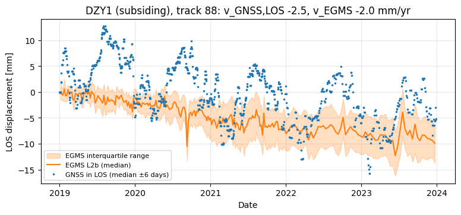
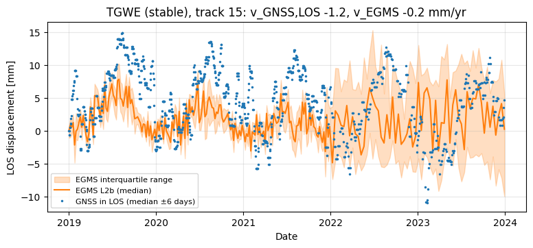

# F9 — E1 Groningen: co pokazują wykresy i liczby, i czy wynik się obroni

> **Data:** 2026-10-12 · **Dotyczy:** `notebooks/EGMS_Check.ipynb` (eksperyment E1, EGMS L2b 2019–2023, 35 stacji GNSS)
> **Przebieg:** Colab, kod `160a0ee`, zapis z wynikami w commicie `a7b13b9`. Liczby **identyczne** z pierwszym przebiegiem
> z 2026-10-10 (kod `fe368e8`): wynik jest powtarzalny.
> **Ryciny:** `docs/evidence/figures/e1_*.png` (kopie wyjść notatnika).
> Poziom weryfikacji: liczby przeliczone niezależnie z tabeli wyników (`docs/migracja/09_audyt_po_migracji.md`, 9.3);
> interpretacje oznaczone „hipoteza” nie były osobno testowane.

---

## 0. W skrócie

- **Pytanie:** czy EGMS (radar satelitarny) podaje to samo tempo osiadania co niezależne stacje GNSS w rejonie Groningen?
- **Odpowiedź:** tak dla **tempa** (trendu): 91% par stacja × ścieżka różni się o ≤ 1,5 mm/rok; nachylenie 0,96.
  Gorzej dla **przebiegu w czasie** (K2 na granicy progu) i dla **stacji „stabilnych”** (K3 niespełnione).
- **Wniosek formalny** (reguła zapisana przed obliczeniami): **CZĘŚCIOWO**.
- **Zdanie na slajd:** „Na 24 stacjach GNSS w Groningen pomiar naziemny potwierdza tempo osiadania widoczne w EGMS
  (2019–2023) z dokładnością ok. 1,5 mm/rok.”

Analogia do całości: porównujemy dwie wagi. GNSS waży codziennie w jednym punkcie, EGMS co 6–12 dni w tysiącach
punktów. Pytamy, czy obie pokazują ten sam spadek „masy” (wysokości) z roku na rok — a nie, czy każde ważenie
wychodzi identycznie.

---

## 1. Dane i źródła

| Co | Źródło | Uwagi |
|---|---|---|
| **EGMS L2b (Calibrated)**, wydanie 2019–2023 | Copernicus Land Monitoring Service, API EGMS (`step_01_ingest.py`); dokumentacja: Product Description (F5) | 31 plików (bursty), 4,4 GB; przemieszczenia w kierunku satelity (LOS) w datach przelotów, mm; dowiązane do modelu prędkości GNSS (siatka ok. 50 km) |
| **GNSS — dobowe szeregi** | Nevada Geodetic Laboratory (NGL), pliki `tenv3` w układzie IGS20, wariant „EU” (ruch płyty euroazjatyckiej odjęty) | Blewitt i in. 2018; licencja: wolne użycie z cytowaniem |
| **GNSS — prędkości do wyboru stacji** | NGL, plik MIDAS `midas.IGS.txt` | Blewitt i in. 2016; tylko do reguły wyboru, nie do porównania |
| **Metoda porównania** | oficjalna walidacja EGMS: Koudogbo i in. 2025 (bufor 100 m, min. 3 punkty, okno ±6 dni) | F4, F7 |
| **Próg prędkości 1,5 mm/rok** | Fabris i Nazari 2026 za Fiaschi i in. 2018 | F4 |
| **Próg szeregów 5 mm** | Crosetto i in. 2025 (EGMS White Paper) | F1 |
| **Kalibracja EGMS do GNSS** | Even i in. 2024; Koudogbo i in. 2025 | ograniczenie niezależności (sekcja 6) |
| **Sezonowość w L2b obciążona kalibracją** | Calero i in. 2023 (raport walidacyjny EEA), cytowane przez Hrysiewicz i in. 2024 | F1; wyjaśnia rozjazd sezonowy na wykresach 2–4 |

**Stacje (reguła, bez wyboru ręcznego, zatwierdzona przed pobraniem EGMS):**
- **27 „osiadających”**: wszystkie stacje NGL w prostokącie 5,8–7,3° E, 52,9–53,6° N z prędkością pionową
  MIDAS ≤ −2 mm/rok, danymi od ≤ 2019.0 do ≥ 2024.25, niepewnością ≤ 1 mm/rok i ≤ 2 skokami;
- **8 „stabilnych”** (kontrola negatywna): stacje z okolicy (do ok. 60 km) z |vu| ≤ 1 mm/rok, najbliższe strefie osiadania.
- Wynik mają 24 stacje osiadające i 8 stabilnych; 3 stacje (AME2, AWG1, KNOC) nie mają punktów EGMS w promieniu 200 m.

---

## 2. Jak powstaje porównanie (5 kroków)

1. **Punkty EGMS przy stacji:** wszystkie punkty w promieniu 100 m; szereg EGMS = mediana punktów w każdej dacie.
2. **GNSS w kierunku satelity:** GNSS mierzy ruch w 3D (wschód, północ, góra), EGMS tylko wzdłuż linii widzenia
   satelity (LOS). Rzutujemy GNSS: `d_LOS = E·los_east + N·los_north + U·los_up` (wektor LOS z punktów EGMS).
3. **Te same daty:** GNSS uśredniony (mediana) w oknie ±6 dni wokół każdego przelotu; oba szeregi zerowane
   w tej samej dacie.
4. **Ta sama prędkość:** oba szeregi dopasowane tym samym modelem (trend + sinusoida roczna) w tym samym oknie.
5. **Różnice:** `dv = v_GNSS,LOS − v_EGMS`; rozrzut różnicy szeregów (std); korelacja.

Konwencja znaku: **ujemne = ruch od satelity** (dla osiadania: w dół).
„Para” = stacja × ścieżka satelity. Jedną stację widzi 4–5 ścieżek (dwie geometrie: wstępująca i zstępująca).

---

## 3. Kontrole przed porównaniem (tabela w sekcji 6 notatnika)

| Kontrola | Co sprawdza | Wynik | Znaczenie |
|---|---|---|---|
| A1 | długość wektora LOS = 1 | odchyłka ≤ 0,0007 | kosinusy kierunkowe poprawne |
| A2 | składowa pionowa LOS = cos(kąta padania) | ≤ 0,0005 | kąt padania spójny z wektorem |
| A3 | znak składowej wschodniej: wstępująca −, zstępująca + | −1 / +1 | geometria orbit zgodna z założeniem |
| A5 | duplikaty punktów z zakładek burstów | 206 usuniętych | punkt nie liczy się dwa razy |

Wszystkie przeszły — błąd znaku albo układu w danych EGMS jest wykluczony (to była jedna z głównych niewiadomych projektu).

---

## 4. Wykres 1 — EGMS kontra GNSS (rozrzut prędkości)

**Co jest na osiach:**
- oś X: prędkość GNSS rzutowana na kierunek satelity [mm/rok] — „prawda naziemna”;
- oś Y: prędkość EGMS L2b (mediana punktów w buforze 100 m) [mm/rok].

**Jak czytać:**
- każdy znacznik = jedna para stacja × ścieżka (126 par);
- **kółka** = orbita wstępująca, **kwadraty** = zstępująca; **pełne** = stacje osiadające, **puste** = stabilne;
- **linia 1:1** = idealna zgodność; **szary pas** = ±1,5 mm/rok (próg K1). Punkt w pasie = zgodność w progu.

**Co pokazuje:**
1. **Chmura leży wzdłuż linii 1:1** — EGMS rośnie razem z GNSS; nachylenie 0,96 (idealnie 1), przesunięcie +0,05 mm/rok.
2. **91% par osiadających w pasie** (86 z 95). Poza pasem głównie ścieżka 88 (sekcja 6).
3. **Dwa kwadraty przy −12 mm/rok to stacja VEEN** (Veendam). Na orbitach zstępujących GNSS −11,7, EGMS −12,1 i −12,8;
   na wstępujących ten sam punkt ma tylko −0,8 do −3 mm/rok. Ruch jest więc silnie zależny od kierunku patrzenia
   (duża składowa pozioma), a **EGMS odtwarza to na wszystkich czterech ścieżkach** (|dv| ≤ 1,2). To najmocniejszy
   pojedynczy dowód w danych (sekcja 7). Przyczyna osiadania w Veendam: według wiedzy ogólnej wydobycie soli
   (ługowanie) — potwierdzić źródłem przed slajdem.
4. **Puste znaczniki (stabilne) skupiają się przy 0, ale nie na 0**: do −2,2 mm/rok w EGMS — i GNSS pokazuje podobnie
   (mediana −0,8). Stąd K3 (sekcja 5).
5. **Kółka leżą przeważnie nad linią, kwadraty pod nią** — systematyczna różnica orbit (sekcja 6).

**Czego wykres nie mówi:** nic o dokładności pojedynczej daty, o miejscach bez punktów EGMS ani o ruchu nagłym.

---

## 5. Wykresy 2–4 — szeregi czasowe w trzech stacjach

Wybór stacji regułą (nie ręcznie): największe osiadanie (AME1), mediana osiadania (DZY1), najmniej ruchliwa stabilna
(TGWE); dla każdej ścieżka z największą liczbą punktów EGMS.

**Jak czytać każdy wykres:**
- **pomarańczowa linia** = EGMS (mediana punktów w buforze), **pomarańczowy pas** = rozrzut między punktami
  (25–75%; im szerszy, tym punkty EGMS mniej zgodne ze sobą);
- **niebieskie kropki** = GNSS rzutowany na LOS, w datach EGMS;
- oba szeregi zaczynają się od 0 w tej samej dacie; w tytule prędkości obu.

### AME1 (Ameland), ścieżka 37 — osiadająca

- **Trend zgodny:** GNSS −4,2, EGMS −4,4 mm/rok; po 5 latach oba ok. −20 mm.
- **GNSS ma silną falę roczną (ok. ±7 mm)**, EGMS prawie jej nie ma. To główny powód, dla którego rozrzut różnicy
  szeregów (K2) wynosi ok. 4,7 mm mimo zgodnego trendu. Literatura: sezonowość w L2b jest obciążona kalibracją GNSS
  i należy ją interpretować ostrożnie (Calero i in. 2023). Możliwy wkład samej stacji GNSS (np. termiczny ruch
  anteny/budynku, obciążenie hydrologiczne) — **hipoteza**, nie sprawdzana.
- **Pojedyncze skoki EGMS** (lipiec 2020, lipiec 2023): wspólne dla wielu punktów jednej daty — artefakt przetwarzania
  lub atmosfery w jednej akwizycji; nie wpływają na trend.

### DZY1 (Delfzijl), ścieżka 88 — osiadająca

- Trend GNSS −2,5, EGMS −2,0 mm/rok (różnica 0,5 — w progu).
- Ta sama fala roczna w GNSS; EGMS gładszy. Szerszy pas pomarańczowy = punkty EGMS przy stacji mniej jednorodne.

### TGWE (stabilna), ścieżka 15 — kontrola negatywna

- EGMS −0,2 mm/rok (praktycznie zero); GNSS w LOS −1,2 mm/rok — stacja „stabilna” według MIDAS też lekko się rusza.
- **Po 2022 r. pas EGMS wyraźnie się poszerza.** Od 23.12.2021 (koniec Sentinel-1B) przeloty są co 12, nie co 6 dni,
  a przy TGWE na tej ścieżce jest tylko ok. 30 punktów. Rzadsze dane = większy szum pojedynczej daty — ważne dla
  pytania o monitoring (etap B).

---

## 6. Liczby — tabela kryteriów (sekcja 8 notatnika)

| Kryterium | Wynik | Próg | Co znaczy |
|---|---|---|---|
| **K1** zgodność tempa | 91% par z \|dv\| ≤ 1,5 mm/rok (n = 95) | ≥ 80% | **spełnione** — główny wynik |
| **K2** zgodność szeregów | mediana std różnicy 4,7 mm (10–90%: 4,3–5,3) | ≤ 5 mm | **spełnione na granicy**; napędza je fala roczna GNSS |
| Bias i rozrzut dv | mediana −0,18; MAD·1,48 = 0,86 mm/rok | — | brak systematycznego zawyżania/zaniżania osiadania |
| **K3** stacje stabilne | max \|v_EGMS\| = 2,22 mm/rok (n = 31) | ≤ 1,5 | **niespełnione** — ale patrz niżej |
| **K4** nachylenie | 0,96 (wyraz wolny +0,05) | ≈ 1 | EGMS nie „ściska” ani nie „rozciąga” skali osiadania |

**Dlaczego K3 nie przeszło (z pełnej tabeli):** 8 z 31 par stabilnych ma |v_EGMS| > 1,5 mm/rok, głównie mareografy
**TGBF (Borkum) i TGEM (Emden)**. GNSS na tych stacjach też nie pokazuje zera (w LOS mediana −0,8 mm/rok). Różnica
EGMS − GNSS przekracza 1,5 mm/rok tylko w **3 z 31 par**. Czyli: stacje „stabilne” według MIDAS (pion, cały okres)
nie są stabilne w kierunku satelity w latach 2019–2023 — zawiodła definicja kontroli, nie EGMS. Werdykt zostaje
CZĘŚCIOWO, bo definicję K3 zapisano przed obliczeniami (w etapie 2020–2024 K3 = |dv|, decyzja z 2026-10-12).

**Różnica orbit (nowe, z tabeli par):** mediana dv dla stacji osiadających wynosi **−0,86 mm/rok na orbitach
wstępujących** i **+0,23 mm/rok na zstępujących** (odsetek w progu: 88% i 94%). Przeciwny znak na dwóch geometriach
to podpis składowej **wschód–zachód**, a nie pionu: różnica ok. 0,9 mm/rok w prędkości wschodniej między GNSS
(NGL „EU”, IGS20) a modelem kalibracji EGMS (ETRF2000) dałaby dokładnie taki obraz — **hipoteza** do sprawdzenia
(F4, sekcja 7: różnice układów odniesienia). Pion jest zgodny lepiej, niż sugeruje sama ścieżka 88.

---

## 7. Czy wynik obroni się na spotkaniu?

### Mocne strony (mów śmiało)

1. **Procedura uczciwa i powtarzalna:** reguła stacji i progi zapisane w kodzie przed obliczeniami; dwa przebiegi
   (10 i 12 października) dają identyczne liczby; kontrole konwencji przeszły.
2. **Zgodność tempa jest wyraźna:** 91% par, wszystkie 24 stacje osiadające w progu po medianie ze ścieżek,
   nachylenie 0,96, bias −0,18 mm/rok.
3. **VEEN:** lokalna, szybka niecka (−12 mm/rok w LOS) z silną składową poziomą — EGMS zgadza się z GNSS na czterech
   ścieżkach i w obu geometriach. Kalibracja EGMS (siatka ok. 50 km) nie mogła wytworzyć sygnału o skali kilku km,
   więc tu zgodność pochodzi z radaru.

### Słabe strony (powiedz sam, zanim ktoś zapyta)

| Pytanie, które może paść | Odpowiedź |
|---|---|
| „Czy to nie kółko — EGMS jest kalibrowany GNSS-em?” | Częściowo tak: absolutny poziom prędkości jest dowiązany do modelu GNSS (Even i in. 2024). Lokalne różnice (VEEN, różnice między stacjami w odległości kilku km) pochodzą z radaru. Test w pełni niezależny to niwelacja NRW (etap 2020–2024). |
| „95 par to dużo, ale ile niezależnych pomiarów?” | 24 stacje osiadające; część stoi parami obok siebie (DZYL/DZY1). Podajemy liczbę stacji, nie tylko par. |
| „Dlaczego K3 nie przeszło?” | Stacje „stabilne” według MIDAS ruszają się w LOS o ok. 1 mm/rok także w GNSS; różnica EGMS–GNSS przekracza próg w 3 z 31 par. Werdykt zostawiliśmy taki, jak wynika z reguły. |
| „Szeregi się rozjeżdżają (fala roczna)” | Sezonowość w L2b jest obciążona kalibracją (Calero i in. 2023); trend, który nas interesuje, jest zgodny. Dlatego K2 jest na granicy. |
| „Ścieżka 88 zaniża osiadanie” | Przeciwny znak różnic na orbitach wst./zst. wskazuje na składową wschód–zachód (układ odniesienia), nie na błąd pionu — hipoteza do sprawdzenia. |
| „Jaka jest niepewność prędkości?” | Niepewności z dopasowania są formalne (szum biały) i zaniżone; nie używamy ich do testów istotności. |
| „Czy to działa wszędzie?” | Jeden region, jedno wydanie, płaski teren, osiadanie 2–12 mm/rok. Nie uogólniamy na szybkie lub nagłe ruchy. |

### Czego nie mówić

- „EGMS wykrył osiadanie” → mów: **„pomiar naziemny potwierdza tempo osiadania widoczne w EGMS”**.
- „EGMS mierzy z dokładnością do dnia / co 6 dni” → EGMS to produkt archiwalny, aktualizowany raz w roku;
  pojedyncza data ma szum kilku mm.
- „Osuwisko” → mówimy „osiadanie”.

### Ocena

**Obroni się**, jeśli przedstawisz go jako: „zgodność tempa osiadania potwierdzona, z jawnymi ograniczeniami”.
Nie obroni się jako „pełna, niezależna walidacja EGMS” — na to potrzebna jest niwelacja (NRW) i etap 2020–2024.

---

## 8. Proponowany układ trzech slajdów

1. **Pytanie i dane:** mapa/lista 24 + 8 stacji, EGMS L2b 2019–2023, metoda w 5 krokach (sekcja 2).
2. **Wynik:** wykres 1 + tabela K1–K4; jedno zdanie wniosku; VEEN jako przykład.
3. **Ograniczenia i dalej:** kalibracja, K3, sezonowość, różnica orbit → etap 2020–2024 (L3, niwelacja NRW,
   monitoring HyP3/MintPy).
